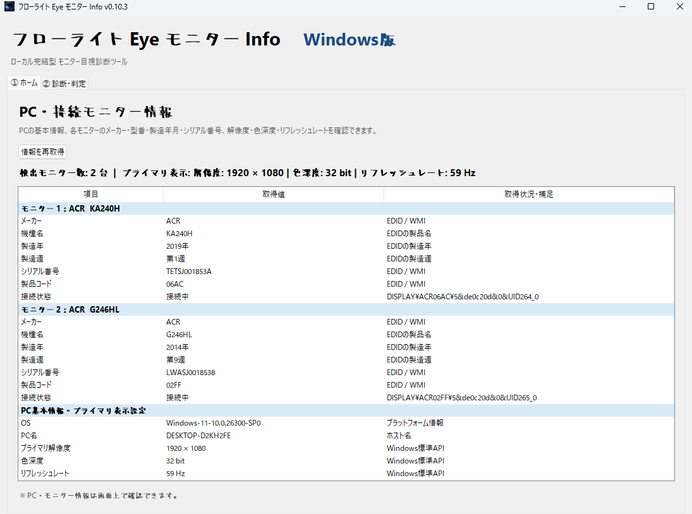
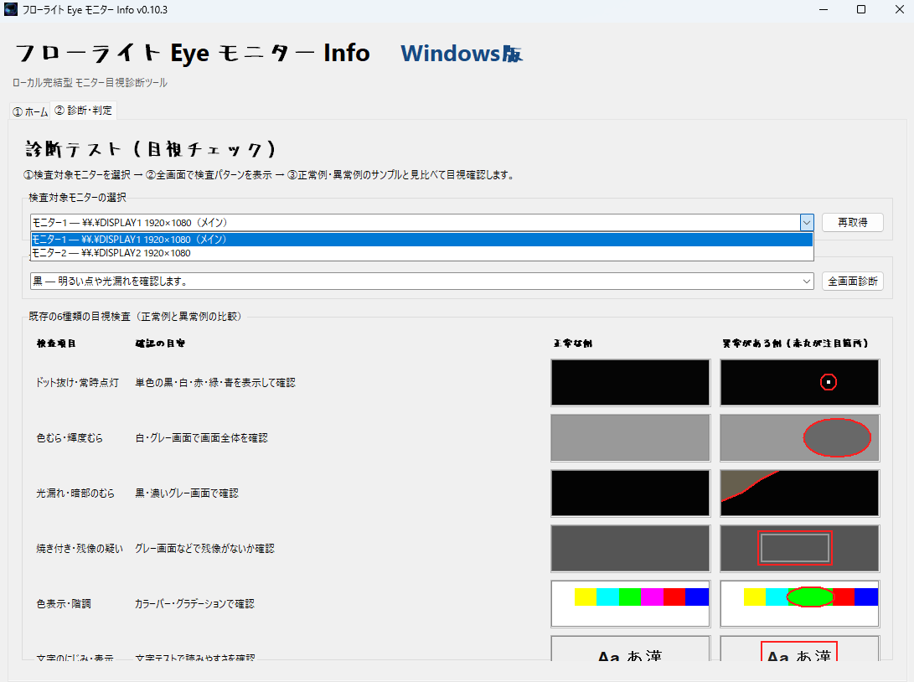

# フローライト Eye モニター Info

**開発：株道経済研究所**  
**Windows向け・モニター情報表示／目視診断ツール**

モニターの情報を確認し、画面の表示状態をチェックするための Windows 向けツールです。

新しく購入したモニターの確認、中古モニターの購入前チェック、長く使っているモニターの定期点検などに活用できます。

CrystalDiskInfo のように、必要なときに起動して機器の状態を確認できる、長く使ってもらえる定番ツールをモニター向けにも作りたい。その発想から、本ソフトの開発を始めました。

本ソフトでは、**取得できる情報は自動表示し、目視が必要な項目は検査パターンやサンプル画像を使って確認する**方式を採用しています。

## 主な機能

### 1. モニター・PC情報の表示

EDID や WMI などから取得できる情報を表示します。

- モニターの機種・製造情報など（取得できる場合）
- モニターの接続情報
- 解像度、色深度、リフレッシュレートなどの表示情報
- PC・Windows に関する情報

取得できる項目は、モニター本体、接続方式、ドライバー、Windows の環境などによって異なります。機種名や製造情報が表示されない場合でも、それだけで故障を意味するものではありません。

### 2. モニターの目視診断

検査パターンやサンプル画像を利用して、画面の表示状態を目視で確認できます。

確認項目の例：

- ドット抜け・常時点灯
- 色むら・輝度むら
- 光漏れや暗部のむら
- 焼き付き・残像の疑い
- 色表示・階調などの表示状態
- 文字や輪郭の表示状態

本ソフトは、不具合を自動検出して故障の有無を断定するものではありません。検査パターンとサンプル画像を使い、利用者自身が目で確認するための診断支援ツールです。

## スクリーンショット

### ホーム画面：モニター・PC情報

モニターから取得できる情報を一覧で確認できます。

### 診断・判定画面：目視によるモニターチェック

検査パターンやサンプル画像を使って、表示状態を目視で確認します。

## こんなときに

- 新しく購入したモニターの表示チェック
- 中古モニターを購入する際の確認
- 長く使っているモニターの定期的なチェック
- 画面の表示に違和感があるときの確認

## 動作環境・起動方法

- **対象OS：** Windows
- **配布形式：** EXE版
- **起動方法：** 配布された EXE ファイルを実行してください。

Windows のセキュリティ警告が表示された場合は、配布元とファイルの内容を確認してから実行してください。

対応する Windows のバージョンや追加の注意事項は、各リリースの説明をご確認ください。

## 無料ダウンロード

本ソフトは無料での配布を予定しています。

公開版は GitHub の **Releases（リリース）** から入手できるようにします。ダウンロードする際は、バージョン番号とリリースの説明をご確認ください。

## 開発者

**株道経済研究所**

本ソフトは、モニターの情報確認と表示チェックを、より手軽に行えるようにすることを目指して開発しています。

利用してくださる方のご意見を参考に、改善を続けていきます。

## 不具合報告・改善要望

不具合の報告や改善案は、GitHub リポジトリの **Issues（課題）** からお寄せください。

報告の際は、可能な範囲で次の情報を記載していただくと、原因の調査に役立ちます。

- Windows のバージョン
- 本ソフトのバージョン
- 発生した操作や状況
- 表示されたエラーメッセージ

## ご利用上の注意

- 表示できる情報は、機器や接続環境によって異なります。
- 目視診断の結果は、モニターの正常性や故障の有無を保証するものではありません。
- 画面の見え方は、モニターの設定や周囲の明るさなどによっても変わります。
- 異常が疑われる場合は、別の接続ケーブルや PC での確認、メーカーの案内なども参考にしてください。

## ライセンス

本ソフトの利用・改変・再配布に関する条件は、リポジトリ内の `LICENSE` ファイルをご確認ください。

## 更新履歴

バージョンごとの主な変更点は [`CHANGELOG.md`](CHANGELOG.md) をご覧ください。
